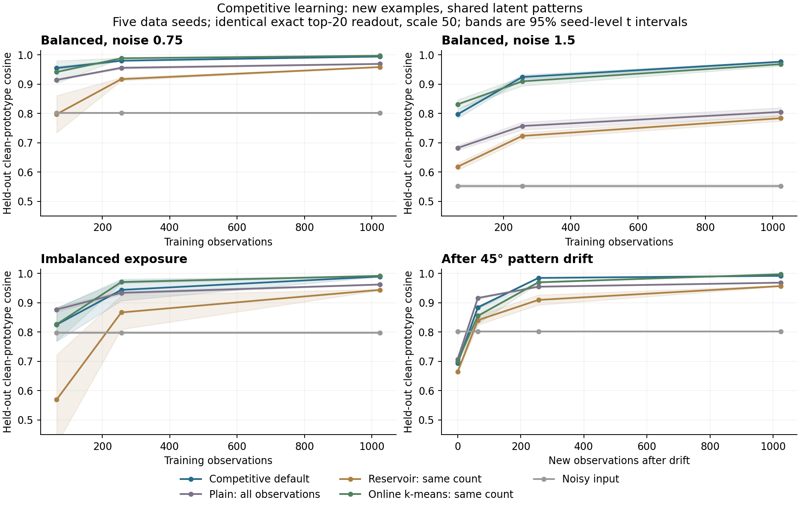
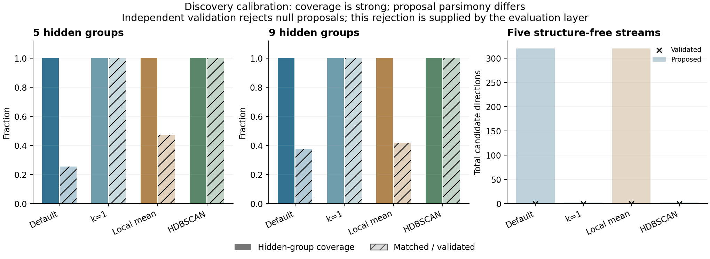

# Competitive learning and discovery evaluation

5 November 2026. Tested repository revision `cb88a2dd203469d2c921bf8ffaaa048790b6de51`;
binary `heather 1.0.0`. This report describes the tested revision only.
The [protocol](../../reference/competitive-learning-protocol.md) defines the frozen workloads and baselines.
No production algorithm or default was altered during this evaluation.

## Finding

**Competitive mode learns shared patterns in this synthetic evaluation.**
It improves prediction of clean latent structure from new noisy observations,
improves as observations accumulate, and adapts after patterns change. This
is a different capability from preserving and recalling every individual row.

On the primary balanced task, default competitive writes reached mean held-out
prototype cosine **0.9941** after 1,024 writes, versus
**0.8009** for the noisy input,
**0.9581** for a same-count reservoir and
**0.9657** for a twice-count reservoir.
The codebook had **289.8 locations on average** (1,024/289.8
= 3.53× fewer locations than observations). A location contains
both address and counter information: this is not a 3.53× RAM or
disk compression claim.

**Competitive mode is also a viable candidate generator for hidden structure
on these calibration tasks.** Every planted group was covered across all five
seeds, for both five and nine groups. Default mode generates many mixed or
redundant candidates; HDBSCAN is markedly more parsimonious here. The external
validation layer rejects null candidates. Native memory does not automatically
validate or abstain, and this is not a new scientific discovery.

## What was learned and how it was tested

The generator supplies noisy observations of orthogonal shared prototypes.
Clean prototypes are never written into the database. No labels or group counts
are passed to competitive writing. New test examples have independent noise.
Training prefixes and test panels are identical across methods, at 128 dimensions
and five data seeds. Each held-out panel has 128 examples, balanced by class.

Actual authenticated HeatherDB writes produce the exported addresses, counters
and counts. For a controlled comparison, all representations use an exact
top-20, count-weighted attention decoder. Primary results fix scale 50 for every
method; scale 5, nearest-address and nearest-counter diagnostics are retained
in the raw data. Baseline clustering is evaluator code, not part of HeatherDB.
Neither the engine nor its defaults was altered for these tests.

The main result is denoising toward a latent shared prototype, not matching a
stored observation. Counts, per-class scores, native-endpoint checks and raw
codebooks prevent interpreting a plausible output alone as learning.

## Held-out prototype fidelity

Mean scale-50 cosine at the final checkpoint, averaged over five data seeds.
The drift column is after 256 old and 1,024 new observations; other columns
use 1,024 observations. Imbalance is scored on a balanced test panel.

| Method | Balanced σ=0.75 | Hard noise σ=1.5 | Imbalanced | After drift |
|---|---|---|---|---|
| Noisy input | 0.8009 | 0.5518 | 0.7983 | 0.8015 |
| Competitive default | 0.9941 | 0.9765 | 0.9896 | 0.9920 |
| Competitive k=1 | 0.9960 | 0.9579 | 0.9932 | 0.9931 |
| Plain: all observations | 0.9689 | 0.8050 | 0.9623 | 0.9686 |
| Reservoir: same count | 0.9581 | 0.7835 | 0.9441 | 0.9571 |
| Reservoir: twice count | 0.9657 | 0.8046 | 0.9581 | 0.9645 |
| Online k-means: same count | 0.9968 | 0.9680 | 0.9920 | 0.9975 |
| Online k-means: K=8 | 0.9053 | 0.9474 | 0.8454 | 0.9291 |
| Online EMA: K=8 | 0.8692 | 0.8801 | 0.8346 | 0.9481 |
| Offline k-means: K=8 | 0.9978 | 0.9911 | 0.9508 | 0.9868 |
| Labelled centroid reference | 0.9978 | 0.9911 | 0.9950 | 0.9868 |

K=8 baselines receive the known generator complexity. The labelled reference
additionally receives training labels and is not an unsupervised contender.
Count-matched baselines receive the competitive codebook count for that
training prefix. The reservoir is a uniform sample of the prefix, recomputed
at each checkpoint; its marginal distribution is reservoir sampling, not a
separately measured live reservoir service. The twice-count reservoir is a
logical two-vector-payload sensitivity check; graphs, caches, storage overhead
and exact byte-budget equivalence are not included.

The simpler baselines matter: count-matched online k-means slightly exceeds
default competitive mode on balanced, imbalanced and drift fidelity, while
competitive mode exceeds it in the high-noise condition. Offline K=8 k-means
is better on balanced and high-noise data. These results establish useful
learning, not universal superiority over clustering methods.

## Primary paired comparisons

The two primary comparisons use five paired seed-level means. Intervals are
97.5% t intervals for two-comparison Bonferroni coverage; queries are not
treated as independent experimental replicates. Both intervals exclude zero.

| Comparison in balanced final condition | Mean difference | 97.5% interval |
|---|---|---|
| Default − Noisy input | +0.1932 | [+0.1908, +0.1956] |
| Default − Reservoir: same count | +0.0359 | [+0.0343, +0.0376] |

The study has five seeds and synthetic data. These model-based intervals do
not establish performance over arbitrary real-world distributions. Other
comparisons and conditions are secondary.

## Learning curves and adaptation

Default competitive balanced fidelity grows from 0.9547 at 64
writes to 0.9799 at 256 and 0.9941 at 1,024. More noisy observations
improve prediction of independent clean structure, rather than just adding
individually retrievable rows.

| Condition | Default final − first fidelity | Paired 95% interval |
|---|---|---|
| balanced | +0.0394 | [+0.0336, +0.0452] |
| hard_noise | +0.1796 | [+0.1645, +0.1947] |
| imbalanced | +0.1642 | [+0.1066, +0.2218] |
| drift | +0.2981 | [+0.2931, +0.3032] |

Under a policy that prioritises current patterns, adaptation includes
graceful forgetting: old-pattern fidelity falls from **0.9799** to
**0.7109**. This is updating the learned representation, not preserving
an immutable episodic archive. Archive requirements need a separate storage
policy; the experiment does not promise both unlimited retention and adaptation.



## Native readout cross-check

Eight preselected held-out queries per seed and checkpoint are also sent to
the actual HTTP attention and iterative-read endpoints. Final default-mode
means below are therefore over 40 native queries per condition, not the full
128-query panels used above.

| Condition | Native attention scale 50 | Native iterative read, default β=5 |
|---|---|---|
| balanced | 0.9941 | 0.9926 |
| hard_noise | 0.9737 | 0.9749 |
| imbalanced | 0.9884 | 0.9876 |
| drift | 0.9918 | 0.9923 |

Native attention agrees with the exact decoder at configured k to numerical
precision in these spot checks. These are quality checks, not latency or
throughput measurements. The k=1 variant uses a top-20 decoder in the controlled
comparison but has native top-1 reads; its controlled score must not be
presented as its native read score. All native k=1 results are retained.

## Discovery: proposals, validation and clean group recovery

Each stream contains either five or nine hidden groups plus 30% isotropic
background, or no groups at all. Training and validation each contain 1,024
independent observations. Methods do not receive the hidden group count.
Candidate directions are generated and deduplicated from training data before
validation, with a 64-proposal cap. Validation uses the frozen spherical-cap
null and binomial/Bonferroni rule in the protocol.

Means across five seeds. A matched candidate has cosine at least 0.9 to a
planted group prototype. Coverage counts each group once; the last column is
the mean per-seed fraction of validated candidates matching an individual
planted group.

| Hidden groups | Method | Proposed | Validated | Groups covered | Matched / validated |
|---|---|---|---|---|---|
| 5 | competitive_default | 60.2 | 58.4 | 5.0/5 | 25.5% |
| 5 | competitive_winner | 22.0 | 22.0 | 5.0/5 | 100.0% |
| 5 | local_average_default | 64.0 | 64.0 | 5.0/5 | 47.2% |
| 5 | hdbscan | 5.0 | 5.0 | 5.0/5 | 100.0% |
| 5 | global_mean | 1.0 | 0.0 | 0.0/5 | 0.0% |
| 9 | competitive_default | 64.0 | 63.8 | 9.0/9 | 37.6% |
| 9 | competitive_winner | 26.8 | 26.8 | 9.0/9 | 100.0% |
| 9 | local_average_default | 64.0 | 64.0 | 9.0/9 | 41.9% |
| 9 | hdbscan | 9.0 | 9.0 | 9.0/9 | 100.0% |
| 9 | global_mean | 1.0 | 0.0 | 0.0/9 | 0.0% |

Default competitive mode covers all groups, but only about 26%–38% of its
validated candidates align closely with an individual planted prototype.
The remainder include mixed directions: validation detects enrichment relative
to isotropic noise, not necessarily a distinct interpretable group. They are
not automatically all false findings, but should not be advertised as distinct
discoveries. Winner-only learning yields much cleaner candidate directions
here, at a different native readout/denoising tradeoff. HDBSCAN finds one clean
validated centroid per hidden group, so this run does not show a discovery
advantage over that simple baseline.

On all **five structure-free streams**, default and winner-only modes still
produce proposals, but **zero are validated**. The local-average baseline and
HDBSCAN also have zero validated candidates on these nulls. This is a small
calibration set, not an empirical false-positive guarantee for arbitrary data.
The validation rule assumes the known isotropic synthetic null. Real data need
domain-appropriate nulls, confound controls and independent replication.

The labelled centroid reference passes the positive control. Thus these
directions are representable and detectable by this encoding and validator;
the null result is not simply an inability to express prototype structure.



## Properties and scope

- Supported: competitive writes learn a compressed representation of repeated
  shared structure and can improve prediction on unseen noisy examples.
- Supported here: the learned representation adapts to a change in shared
  patterns, with measured graceful forgetting of earlier patterns.
- Supported as a calibration result: learned counters can propose all planted
  hidden groups, with independent validation rejecting the tested nulls.
- Not established: general semantic reasoning, a novel scientific discovery,
  superiority to standard clustering, or native automatic discovery validation.
- Discovery work remains in stable candidate selection, deduplication,
  interpretation and real-data validation. Do not change the default to k=1
  from this one study: its cleaner proposals do not dominate native denoising.

Individual-pattern recall and shared-pattern learning are separate measurements
of associative memory. Evaluate both when both matter to the application.

## Evidence and reproduction

- [Frozen protocol](../../reference/competitive-learning-protocol.md)
- [All checkpoint, baseline, comparison and discovery results](competitive-learning-results.json)
- Source hashes, executable checksum, package versions, dataset hashes and
  snapshot checksums are included in that JSON. Actual codebooks and score
  arrays are retained locally at the runner’s `--artifacts` path;
  80 NPZ artifacts, approximately 105.9 MiB, are retained locally
  rather than committed as generated binary data.
- Public API overload-split randomness has no exposed seed. Inputs are seeded,
  but this is one engine realization per data seed, not bitwise replay.
- A one-seed reduced smoke run tested implementation before the frozen full
  run. No production algorithm or hyperparameter changes followed full results.

Use Python 3.12 with `scripts/competitive-learning-requirements.txt` and
Matplotlib to render figures. From the engine checkout:

```bash
cargo build --release --locked -p heather_server
python scripts/evaluate_competitive_learning.py --binary target/release/heather --output /tmp/learning.json --artifacts /tmp/learning-artifacts
python scripts/summarize_competitive_learning.py /tmp/learning.json --output /tmp/competitive-learning.md
```

The binary must match the source being evaluated. All database data and
credentials are temporary; no production data or service is used.
